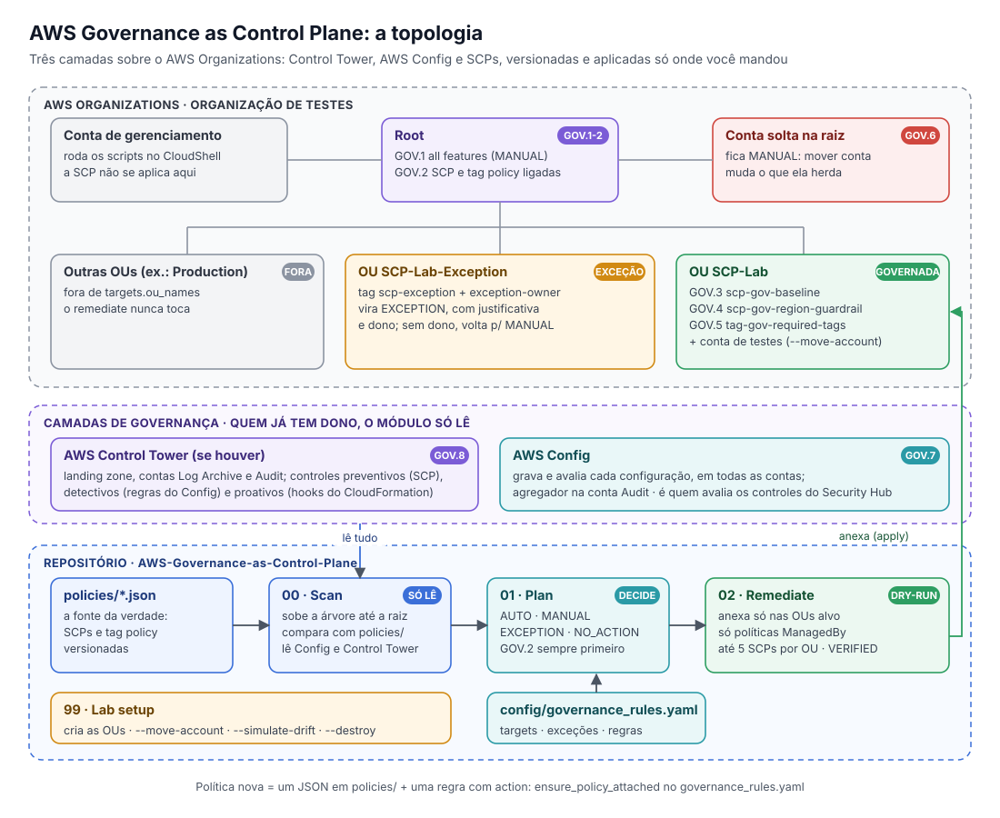

# AWS Governance as Control Plane

<p align="center">
  <a href="#-português">Português</a> •
  <a href="#-english">English</a>
</p>

<p align="center">
  
</p>

---

## 🇧🇷 Português

No episódio anterior, o Security Hub mostrou o que já estava errado e a gente corrigiu. Mas e se desse para impedir o problema **antes** de ele acontecer?

É disso que este repositório trata. Quando a empresa cresce, cada time ganha a sua conta, e cada conta tem um administrador que pode, por exemplo, desligar o CloudTrail ou subir máquinas numa região que ninguém monitora. A governança aqui tem três camadas, todas em cima do AWS Organizations:

- **AWS Control Tower**, que monta a landing zone e traz um catálogo de controles prontos;
- **AWS Config**, que registra e avalia a configuração de cada recurso, em todas as contas;
- **Service Control Policies (SCPs)** e tag policies, que definem **limites que valem para a organização inteira**, escritos em código e versionados aqui no repositório.

> Este repositório faz parte da série **AWS Security Control Plane** e nasce do template [AWS Security Control Plane Scripts](https://github.com/wagnermazevedo/AWS-Security-Control-Plane-Scripts): mesmo contrato, mesmas saídas, mesmo `test-control-plane.sh`.
>
> ⚠️ **Rode numa organização de testes.** Este módulo cria e anexa SCPs, e uma SCP mal escrita pode trancar contas inteiras.

### Antes de começar: como as três camadas se encaixam

O **Control Tower** organiza a casa: cria a landing zone (com as contas de Log Archive e Audit), registra as OUs e oferece controles de três tipos. Os **preventivos** viram SCPs, os **detectivos** viram regras do AWS Config, e os **proativos** viram hooks do CloudFormation, que barram o recurso antes de ele nascer.

O **AWS Config** é a memória da configuração. Ele grava cada mudança e avalia regras, e é ele que está por trás dos controles do Security Hub do episódio anterior. Com um agregador na conta de auditoria, você enxerga a organização inteira num lugar só.

As **SCPs** são o teto. Este módulo usa as próprias SCPs, versionadas em `policies/`, e convive com o Control Tower: ele só mexe em políticas com a tag dele, nunca nas do Control Tower.

### O que é uma SCP, afinal?

Uma SCP **não dá permissão a ninguém**. Ela define o teto: mesmo que uma role tenha `AdministratorAccess`, ela não consegue fazer o que a SCP nega. Isso vale até para o usuário root das contas-membro.

Só tem uma exceção importante: a SCP **não se aplica à conta de gerenciamento**. Por isso a boa prática é não rodar nenhum workload nela. Lá mora só a governança.

### Os controles deste episódio

| Controle | O que ele verifica | O que o código faz |
|---|---|---|
| **GOV.1** | A organização usa *all features* (sem isso, não existe SCP) | Avisa (MANUAL) |
| **GOV.2** | SCPs habilitadas na raiz | Corrige sozinho (AUTO) |
| **GOV.3** | SCP baseline na OU: não sair da organização, não desligar CloudTrail, Config, GuardDuty, Security Hub e Access Analyzer, e bloquear o root das contas-membro | Corrige sozinho (AUTO) |
| **GOV.4** | SCP de regiões na OU: só `us-east-1` e `sa-east-1` (você escolhe) | Corrige sozinho (AUTO) |
| **GOV.5** | Tag policy na OU: padroniza `Environment`, `Owner` e `CostCenter` | Corrige sozinho (AUTO) |
| **GOV.6** | Contas-membro soltas na raiz, fora de uma OU | Avisa (MANUAL) |
| **GOV.7** | AWS Config agregando a organização (agregador ou administrador delegado, como a conta Audit) | Avisa, com runbook (MANUAL) |
| **GOV.8** | Control Tower: controles habilitados em cada OU alvo, sem drift | Avisa (MANUAL); sem Control Tower, fica `NOT_APPLICABLE` |

O GOV.1 e o GOV.6 ficam manuais de propósito. Migrar para *all features* exige o aceite de cada conta-membro, e mover uma conta de OU muda as políticas que ela herda. Isso é decisão de arquitetura, não de script.

O GOV.7 e o GOV.8 só leem. O agregador do Config e os controles do Control Tower têm dono próprio (a conta Audit e o Control Tower), e o módulo não briga com eles: ele mostra o que falta e aponta o caminho.

### Como funciona: scan, plan e remediate

1. **Scan, que só olha.** Avalia cada controle nas OUs que você listou em `targets.ou_names`. Ele sobe a árvore até a raiz, porque uma política anexada mais acima também protege a OU. E compara o conteúdo com o arquivo da pasta `policies/`: se alguém editou a política pelo console, aparece como `CONTENT_DRIFT`.
2. **Plan, que só decide.** Cruza cada item com o `config/governance_rules.yaml` e escreve um plano: `AUTO`, `MANUAL`, `EXCEPTION` ou `NO_ACTION`. O GOV.2 vai sempre primeiro, porque não dá para anexar SCP antes de habilitar SCP.
3. **Remediate, que age com cuidado.** Por padrão roda em dry-run. No modo apply, confere o estado ao vivo, habilita o tipo de política, cria ou restaura a política, anexa na OU e confere tudo de novo no final (`VERIFIED`).

> **A regra de ouro:** nada é alterado sem querer. Em dry-run, nenhuma API de escrita é chamada.

**As travas de segurança do próprio remediate:**
- só anexa nas OUs de `targets.ou_names`, nunca na raiz nem direto numa conta;
- só cria ou altera políticas com a tag `ManagedBy=aws-governance-control-plane`; se já existir uma política com o mesmo nome e outro dono, ele para e pede revisão;
- uma OU com a tag `scp-exception` vira `EXCEPTION`, com justificativa e dono (`exception-owner`); sem dono, volta para `MANUAL`;
- as SCPs liberam roles `breakglass-*`, para sempre existir uma saída de emergência auditável;
- cada política é validada contra o limite de tamanho do AWS Organizations antes de ser enviada;
- respeita a cota de políticas por OU (5 SCPs). Com Control Tower ela enche rápido, então o remediate para com uma mensagem clara (`QUOTA`) em vez de falhar no meio do apply.

### Mão na massa no AWS CloudShell

Rode na conta de **gerenciamento** de uma organização de testes.

**1. Clone e instale**

```bash
cd ~
git clone https://github.com/wagnermazevedo/AWS-Governance-as-Control-Plane.git
pip3 install --user -r ~/AWS-Governance-as-Control-Plane/requirements.txt
```

**2. Monte o laboratório**

```bash
python3 ~/AWS-Governance-as-Control-Plane/scripts/99_governance_lab_setup.py
```

O script 99 cria duas OUs: a `SCP-Lab`, que a gente vai governar, e a `SCP-Lab-Exception`, que já nasce com a tag de exceção e um dono. Nenhuma política anexada ainda.

Quer ver a SCP funcionando de verdade? Mova uma conta-membro **de testes** para a `SCP-Lab`:

```bash
python3 ~/AWS-Governance-as-Control-Plane/scripts/99_governance_lab_setup.py --move-account <ID-da-conta-de-testes>
```

**3. Rode o ciclo**

```bash
cd ~
python3 ~/AWS-Governance-as-Control-Plane/scripts/00_governance_scan.py --region us-east-1
python3 ~/AWS-Governance-as-Control-Plane/scripts/01_governance_plan.py
python3 ~/AWS-Governance-as-Control-Plane/scripts/02_governance_remediate.py --region us-east-1 --mode dry-run
python3 ~/AWS-Governance-as-Control-Plane/scripts/02_governance_remediate.py --region us-east-1 --mode apply
```

Não precisa passar caminho nenhum: o plan pega sozinho o scan mais recente em `outputs/` e grava `outputs/remediation_plan.yaml`, que o remediate lê. Para usar um scan específico, passe `--input-yaml` para o plan (e `--yaml` para o remediate).

Ou deixe o orquestrador do template fazer tudo (rode a partir do `$HOME`):

```bash
~/AWS-Governance-as-Control-Plane/test-control-plane.sh AWS-Governance-as-Control-Plane dry-run
```

Agora, na conta-membro que está na `SCP-Lab`, tente `aws cloudtrail stop-logging --name <trail>`. A resposta é `AccessDenied`, mesmo com AdministratorAccess.

**4. Simule alguém mexendo pelo console**

```bash
python3 ~/AWS-Governance-as-Control-Plane/scripts/99_governance_lab_setup.py --simulate-drift   # tira a proteção do CloudTrail da SCP baseline
python3 ~/AWS-Governance-as-Control-Plane/scripts/00_governance_scan.py --region us-east-1      # o GOV.3 volta como CONTENT_DRIFT
```

Rode o plan e o apply de novo, e o texto que está no repositório volta para a política.

**5. Arrume a casa**

```bash
python3 ~/AWS-Governance-as-Control-Plane/scripts/99_governance_lab_setup.py --destroy
```

Devolve a conta movida para a raiz, apaga só as políticas deste módulo (e só se não estiverem anexadas fora do laboratório) e remove as OUs. Os tipos de política continuam habilitados de propósito: desabilitar SCP desanexa todas as SCPs da organização.

### Quer adicionar uma política nova?

A boa notícia: para políticas, você não precisa escrever código. Usando como exemplo um **GOV.9** com uma Resource Control Policy que só deixa identidades da organização acessarem os buckets S3:

1. **Escreva a política.** Crie `policies/rcp-gov-s3-org-only.json` com o JSON da política.
2. **Declare no mapa.** Em `config/governance_rules.yaml`, adicione:

   ```yaml
   GOV.9:
     title: "RCP: S3 só para identidades da organização"
     decision: AUTO
     action: ensure_policy_attached
     params:
       policy_type: RESOURCE_CONTROL_POLICY
       policy_name: rcp-gov-s3-org-only
       policy_file: policies/rcp-gov-s3-org-only.json
       enable_type_if_needed: true
     mitre: []
   ```

3. **Pronto.** Toda regra com `action: ensure_policy_attached` é avaliada em cada OU alvo pelo scan e aplicada pelo remediate, com as mesmas travas: drift, dono da política, exceção e limite de tamanho. O `enable_type_if_needed` habilita o tipo de política na raiz se ainda estiver desligado.
4. **Teste.** Adicione o arquivo na lista de `test_policies_fit_size_limits`, em `tests/test_control_plane.py`, e rode os testes. O teste `NewPolicyControl` mostra esse mesmo exemplo funcionando.

Quer um controle que **não** é "anexar uma política" (por exemplo, checar um administrador delegado)? Aí você escreve a verificação em `scanner/controls.py` e, se for AUTO, uma ação nova em `remediate/` registrada no `remediate/__init__.py`.

### O que fica salvo em cada execução

Cada execução cria uma pasta nova em `outputs/<timestamp>/`, e nada é sobrescrito:

- **YAML** (`governance_scan_export.yaml`): a entrada do plan.
- **JSON:** a fonte da verdade.
- **CSV:** pronto para o Amazon Athena.
- **Markdown** (`summary.md`): um resumo para ler rápido.

O remediate registra cada chamada de API que fez (`changes`). Se um auditor perguntar quem mudou a política e quando, a resposta está ali. Ele grava JSON, CSV e Markdown, mas não YAML, para o `test-control-plane.sh` continuar achando o YAML do scan mais recente.

### Permissões necessárias

- **Scan:** `organizations:Describe*`, `organizations:List*`, `config:DescribeConfigurationRecorderStatus`, `config:DescribeConfigurationAggregators`, `controltower:ListLandingZones`, `controltower:ListEnabledControls`, `sts:GetCallerIdentity`
- **Região:** rode na região de origem (*home region*) do Control Tower, se você usa um. É nela que o GOV.8 encontra a landing zone.
- **Apply:** além das de scan, `organizations:EnablePolicyType`, `CreatePolicy`, `UpdatePolicy`, `AttachPolicy` e `TagResource`
- **Laboratório:** `cloudformation:*` na stack do lab, `organizations:CreateOrganizationalUnit`, `DeleteOrganizationalUnit`, `MoveAccount`, `DetachPolicy` e `DeletePolicy`

### Testes

```bash
python3 -m unittest discover -s ~/AWS-Governance-as-Control-Plane/tests -v
```

Os testes rodam numa organização simulada, sem precisar de AWS, e validam cada chamada contra o modelo oficial da API do botocore. Eles cobrem o scan sem escrita, o dry-run sem escrita, as decisões do plano, exceções sem dono, drift, a recusa em mexer em política de outro dono, uma política nova adicionada só pelo mapa, e o setup e destroy do laboratório.

### Onde fica cada coisa

```text
AWS-Governance-as-Control-Plane/
├── test-control-plane.sh          # Orquestrador de testes do template
├── scripts/
│   ├── 00_governance_scan.py      # Olha
│   ├── 01_governance_plan.py      # Decide
│   ├── 02_governance_remediate.py # Age
│   └── 99_governance_lab_setup.py # Monta, simula drift e desmonta o laboratório
├── config/governance_rules.yaml   # O cérebro: o destino de cada controle
├── policies/                      # SCPs e tag policy versionadas (a fonte da verdade)
├── scanner/                       # Leitura da organização e avaliação dos controles
├── remediate/                     # Uma correção pequena por tipo de ação
├── lab_insecure/                  # CloudFormation das OUs do laboratório
├── tests/                         # Testes offline
├── lib/                           # Clientes AWS, saídas e políticas
├── reports/                       # Relatórios consolidados
├── outputs/                       # Saídas de cada execução
└── docs/                          # Arquitetura, controles e topologia
```

### Desafio da semana

Escreva o GOV.9! Siga o passo a passo acima, adapte a RCP para a sua organização (`aws:PrincipalOrgID`) e mande um pull request. Os melhores aparecem no próximo episódio.

---

## 🇺🇸 English

In the previous episode, Security Hub showed what was already wrong and we fixed it. What if we could prevent the problem **before** it happens?

That is what this repository is about. Governance here has three layers on top of AWS Organizations: **AWS Control Tower** (landing zone and a catalog of preventive, detective and proactive controls), **AWS Config** (records and evaluates every resource configuration across accounts) and **Service Control Policies** plus tag policies (**organization-wide limits**, written as code and versioned right here). The module ships its own SCPs and coexists with Control Tower: it only touches policies tagged as its own.

> Part of the **AWS Security Control Plane** series, created from the [AWS Security Control Plane Scripts](https://github.com/wagnermazevedo/AWS-Security-Control-Plane-Scripts) template.
>
> ⚠️ **Use a test organization.** This module creates and attaches SCPs.

**Quick reminder:** an SCP never grants permissions, it sets the ceiling. It applies even to member-account root users, but not to the management account.

### Controls

GOV.1 all features enabled (manual) · GOV.2 SCPs enabled at the root · GOV.3 baseline SCP (stay in the org, protect security services, deny member-account root) · GOV.4 region guardrail SCP · GOV.5 tag policy · GOV.6 accounts directly under the root (manual) · GOV.7 AWS Config aggregating the organization (read-only) · GOV.8 Control Tower controls on target OUs (read-only, `NOT_APPLICABLE` without Control Tower).

### Safety rails

Policies are attached only to OUs listed in `targets.ou_names` (never the root); only policies tagged `ManagedBy=aws-governance-control-plane` are created or updated; drift against `policies/` is detected and restored; OUs tagged `scp-exception` with an owner become `EXCEPTION`; `breakglass-*` roles are exempt; dry-run is the default.

### Quick start (AWS CloudShell, management account of a test organization)

```bash
cd ~ && git clone https://github.com/wagnermazevedo/AWS-Governance-as-Control-Plane.git
pip3 install --user -r ~/AWS-Governance-as-Control-Plane/requirements.txt
python3 ~/AWS-Governance-as-Control-Plane/scripts/99_governance_lab_setup.py                 # build the lab OUs
~/AWS-Governance-as-Control-Plane/test-control-plane.sh AWS-Governance-as-Control-Plane dry-run
python3 ~/AWS-Governance-as-Control-Plane/scripts/99_governance_lab_setup.py --destroy       # clean up
```

### Adding a new policy

No code needed: drop the JSON in `policies/` and add a rule with `action: ensure_policy_attached` (with `policy_type`, `policy_name`, `policy_file` and optionally `enable_type_if_needed`) to `config/governance_rules.yaml`. The scan evaluates it on every target OU and the remediate applies it with the same safety rails. See the `NewPolicyControl` test for a working GOV.9 RCP example.

### Outputs and tests

Every run writes a new `outputs/<timestamp>/` folder (YAML, JSON, CSV for Athena, and `summary.md`) that is never overwritten. Offline tests: `python3 -m unittest discover -s ~/AWS-Governance-as-Control-Plane/tests -v`.
